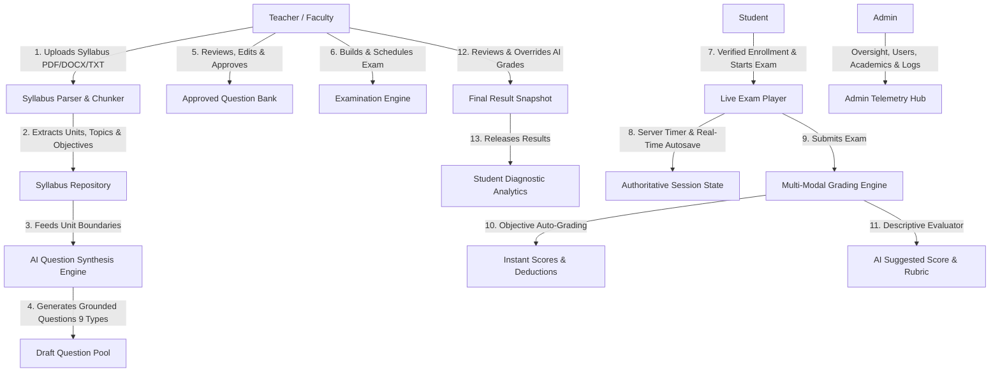

# ExaminAI: AI-Powered Online Examination & Assessment System

[](https://nodejs.org/)
[](https://reactjs.org/)
[](https://vitejs.dev/)
[](https://www.mongodb.com/)
[](https://openai.com/)

A complete, production-grade, full-stack AI-Based Online Examination System that automatically parses uploaded academic syllabuses (PDF, DOCX, TXT), extracts units/topics, generates Bloom's taxonomy-aligned questions, provides teacher review workflows, enforces server-authoritative timed examinations, and delivers instant objective auto-scoring alongside AI-assisted descriptive answer grading.

---

## 1. System Architecture & Flow



---

## 2. Key Features by Role

### 👑 Admin Module
- **System Telemetry Dashboard**: Real-time KPI counters (Students, Teachers, Programs, Subjects, Live Exams, Question Bank Volume, Overall Pass Rates).
- **User Management**: Search, filter by role (Student, Teacher, Admin), create accounts, toggle active/deactivated status.
- **Academic Hierarchy**: Complete control over Departments, Degree Programs, Classes/Batches, Subjects, and Faculty Course Assignments.
- **Exam Oversight**: View all examinations across departments; reschedule or cancel exams with administrative reason tracking.
- **AI & System Configuration**: Switch primary LLM models (`gpt-4o-mini`, `gpt-4o`, custom), file upload limits (15MB), passing mark defaults, and global policies.
- **Immutable Audit Trail**: Chronological event logging with user metadata, IP address, action types, and entity diffs.

### 👨‍🏫 Teacher Module
- **Syllabus Document Processing**:
  - Upload syllabuses in `.pdf`, `.docx`, or `.txt` formats.
  - Automatic text extraction (`pdf-parse`, `mammoth`, UTF-8).
  - Intelligent document chunker segments content into Units, Chapters, Topics, and Learning Objectives.
  - Interactive UI to review and refine extracted topics before synthesis.
- **AI-Powered Question Synthesis**:
  - Grounds generation strictly within uploaded syllabus units (no hallucinations).
  - Supports **9 Question Formats**:
    1. Multiple Choice Questions (MCQ)
    2. Multiple-Select Questions
    3. True / False
    4. Fill in the Blanks
    5. Match the Following
    6. Short-Answer Questions
    7. Long Descriptive Questions
    8. Numerical / Problem-Solving Questions
    9. Case-Study-Based Questions
  - Configurable Difficulty Distribution sliders (Easy %, Medium %, Hard %).
  - Bloom's Cognitive Taxonomy targeting (Remember, Understand, Apply, Analyze, Evaluate, Create).
- **Question Bank & Review Workflow**:
  - Preview generated questions with explanations, answer keys, and syllabus topic citations.
  - AI questions are strictly saved as `draft` status until teacher explicitly approves them.
  - Edit wording, options, marks, or reject with a reason.
  - Manually author custom questions into the bank.
- **Examination Builder**:
  - Manual question selection or random draws from approved question pool.
  - Schedule start/end dates, duration in minutes, total marks, passing marks, and attempt limits.
  - Question randomization and option shuffling toggles.
  - Configurable negative marking (e.g. 25% penalty on wrong objective answers).
  - Results release controls (immediate upon submit or scheduled).
- **AI-Assisted Descriptive Grading Review**:
  - View student submissions for short answers, long essays, and case studies.
  - AI generates suggested marks, confidence rating, rubric assessment breakdown, missing concepts, and student feedback.
  - Teachers review suggestions, adjust scores with custom override reasons, and release final grades.
  - One-click gradebook export to CSV format.

### 🎓 Student Module
- **Student Dashboard**: Live cards for enrolled courses, available exams, upcoming exams, active sessions, and recent grades.
- **Active Exam Alert**: Sticky warning banner displaying remaining time if an exam session is in progress.
- **Pre-Exam Instructions**: View duration, marks, rules, negative marking alerts, and require mandatory agreement before initiation.
- **Online Examination Player**:
  - Server-authoritative countdown clock (hours, minutes, seconds) with amber and red alert states.
  - Automatic submission when the server-defined deadline expires.
  - Interactive **Question Palette** tracking status: Answered (Green), Marked for Review (Purple), Unanswered (Slate).
  - Real-time backend autosave with debounce and animated status dot.
  - Clean question renderers for all 9 question types.
  - Submission confirmation modal showing answered vs unanswered question tallies.
- **Performance Diagnostics & Learning Analytics**:
  - Large pass/fail performance certificate card.
  - Topic-wise mastery percentage progress bars.
  - Identified strengths (topics $\ge$ 70%) and priority improvement areas (topics $<$ 60%).
  - Recommended study and revision strategy.
  - Question-by-question review showing student's submitted answer, authorized model answer key, pedagogical explanation, and teacher feedback.

---

## 3. Technology Stack

| Layer | Technologies & Packages |
|---|---|
| **Frontend** | React 18, Vite 6, React Router DOM v6, Lucide React, Custom CSS Design System |
| **Backend** | Node.js v24, Express.js 4.x, REST API Architecture |
| **Database** | MongoDB, Mongoose 8.x with indexed schemas |
| **Authentication** | JWT (JSON Web Tokens), Bcrypt.js, Role-Based Access Control (RBAC) |
| **AI Integration** | OpenAI SDK (`gpt-4o-mini`), Bloom's Taxonomy Engine, Resilient Self-Hosted Grounded Generator |
| **File Processing** | Multer, `pdf-parse`, `mammoth` |
| **Security & Auditing** | `express-rate-limit`, CORS configuration, AuditLog collection |

---

## 4. Pre-Configured Demo Credentials

The database comes pre-seeded with test accounts across all roles (`Password123!` for all):

| Role | Email | Password | Access Level |
|---|---|---|---|
| **Administrator** | `admin@exam.edu` | `Password123!` | Global administrative controls & settings |
| **Instructor / Teacher** | `teacher@exam.edu` | `Password123!` | Syllabus management, AI generation, grading |
| **Student 1** | `student@exam.edu` | `Password123!` | Online exam player, results & analytics |
| **Student 2** | `student2@exam.edu` | `Password123!` | Additional student account for testing |

> [!TIP]
> The login page at `http://localhost:5173/login` includes **1-Click Demo Buttons** for Admin, Teacher, and Student to test the system instantly without typing!

---

## 5. Quick Start & Setup Guide

### Prerequisites
- Node.js (v18.x or later)
- MongoDB running locally (default: `mongodb://127.0.0.1:27017/ai_examination_system`)

### 1. Clone & Install Dependencies
```bash
# Clone the repository
git clone https://github.com/rubaladha26-wq/online-examination-system.git
cd online-examination-system

# Install backend dependencies
cd server
npm install

# Install frontend dependencies
cd ../client
npm install
```

### 2. Environment Configuration
The backend configuration is located in `server/.env`:
```env
PORT=5000
MONGODB_URI=mongodb://127.0.0.1:27017/ai_examination_system
JWT_SECRET=super_secret_jwt_exam_key_987654321_secure_random
JWT_EXPIRES_IN=7d
CLIENT_URL=http://localhost:5173
OPENAI_API_KEY=your_api_key_here
OPENAI_MODEL=gpt-4o-mini
UPLOAD_MAX_FILE_SIZE_MB=15
NODE_ENV=development
```
*(Note: If no `OPENAI_API_KEY` is provided, the platform automatically utilizes its intelligent syllabus-grounded generator & rubric evaluator, ensuring 100% offline functionality!)*

### 3. Seed Database
Initialize sample academic data, users, parsed syllabus, and a ready-to-take live exam:
```bash
cd server
npm run seed
```

### 4. Start Services
In one terminal, start the Express backend:
```bash
cd server
npm start
# Server runs at http://localhost:5000
```

In a second terminal, start the Vite frontend:
```bash
cd client
npm run dev
# Frontend runs at http://localhost:5173
```

Open your browser and navigate to: **`http://localhost:5173`**

---

## 6. API Route Reference

### Authentication (`/api/auth`)
- `POST /api/auth/login` - Authenticate user & issue JWT
- `POST /api/auth/register` - Register student or teacher (admin registration disabled)
- `GET /api/auth/me` - Fetch authenticated user profile & role
- `POST /api/auth/logout` - Invalidate session

### Administration (`/api/admin`)
- `GET /api/admin/dashboard` - Global metrics & upcoming exams
- `GET /api/admin/users` - Paginated user directory with filters
- `POST /api/admin/users` - Create user
- `PATCH /api/admin/users/:id/toggle-status` - Activate / deactivate account
- `GET /api/admin/departments` - List departments
- `POST /api/admin/departments` - Create department
- `GET /api/admin/courses` - List academic courses
- `POST /api/admin/courses` - Create course
- `GET /api/admin/batches` - List classes/batches
- `POST /api/admin/batches` - Create batch
- `GET /api/admin/subjects` - List subjects & mappings
- `POST /api/admin/subjects` - Create subject
- `POST /api/admin/subjects/:id/assign-teacher` - Assign instructor to subject
- `GET /api/admin/exams` - Monitor all examinations
- `PATCH /api/admin/exams/:id/status` - Administrative exam reschedule/cancellation
- `GET /api/admin/settings` - View system & AI configuration
- `PUT /api/admin/settings` - Update AI models & upload limits
- `GET /api/admin/audit-logs` - System audit log history

### Instructor (`/api/teacher`)
- `GET /api/teacher/dashboard` - Instructor statistics & recent submissions
- `POST /api/teacher/syllabuses` - Upload syllabus file (PDF, DOCX, TXT)
- `GET /api/teacher/syllabuses` - List syllabuses
- `GET /api/teacher/syllabuses/:id` - View extracted units & topics
- `PUT /api/teacher/syllabuses/:id/units` - Update syllabus units/topics
- `POST /api/teacher/syllabuses/:id/generate-questions` - Synthesize questions with AI
- `GET /api/teacher/questions` - Search question bank with filters
- `POST /api/teacher/questions` - Create manual question
- `PUT /api/teacher/questions/:id` - Edit question wording/options/key
- `POST /api/teacher/questions/:id/approve` - Approve draft question
- `POST /api/teacher/questions/:id/reject` - Reject draft question with reason
- `DELETE /api/teacher/questions/:id` - Delete question
- `GET /api/teacher/exams` - List teacher examinations
- `POST /api/teacher/exams` - Create examination
- `POST /api/teacher/exams/:id/publish` - Publish exam
- `GET /api/teacher/exams/:id/attempts` - View student attempts & submissions
- `POST /api/teacher/attempts/:attemptId/override-grading` - Override AI descriptive grades
- `POST /api/teacher/exams/:id/release-results` - Release results to students
- `GET /api/teacher/exams/:id/export-csv` - Export gradebook to CSV

### Student (`/api/student`)
- `GET /api/student/dashboard` - Available exams & summary stats
- `GET /api/student/exams` - List available examinations
- `GET /api/student/exams/:id/instructions` - Get exam rules & attempt limits
- `POST /api/student/exams/:examId/start` - Start attempt (returns questions without keys)
- `GET /api/student/attempts/:attemptId` - Resume active session
- `PUT /api/student/attempts/:attemptId/answers/:questionId` - Autosave student answer
- `POST /api/student/attempts/:attemptId/submit` - Final exam submission & auto-scoring
- `GET /api/student/results` - View released results
- `GET /api/student/results/:resultId` - Diagnostic performance report & solutions

---

## 7. Testing with Postman

Import `postman_collection.json` located at the project root into Postman to execute integration tests across all endpoints. Pre-set environment variables include:
- `baseUrl`: `http://localhost:5000`
- `adminToken`, `teacherToken`, `studentToken`

---

## 8. License & Fair Use
Developed for educational assessment, academic integrity, and curriculum-grounded automated examination workflows.